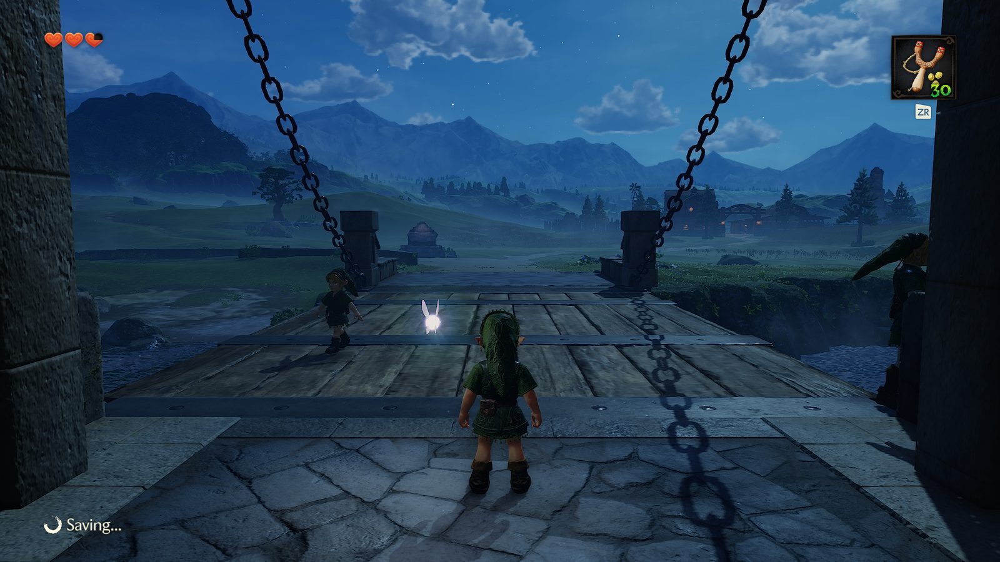

# OoT Online

**Ocarina of Time, together.** A shared Hyrule Field for The Legend of Zelda: Ocarina of Time (the 2026 Nintendo Switch 2
game), played natively on Apple-silicon Macs. Everyone joins one server: you see each other, chat, pick your tunic in the
game's own menu, and shoot each other with arrows and slingshot seeds. Go down and you are back a few seconds later.

Website: **https://bhoneka.github.io/oot-online/**



## You need

- A Mac with an Apple chip (M1 or later) on macOS 26.6 or later, and about 60 GB free.
- **Your own copy of the game**, dumped from your own Switch 2 as a `.nup` file. OoT Online contains nothing from the game
  and downloads nothing from it: it builds the game from your file, on your Mac.
- Xcode from the App Store (for its Metal shader compiler), then once in Terminal:
  `xcodebuild -downloadComponent MetalToolchain`
- [Homebrew](https://brew.sh).

## Install

Open Terminal and paste:

```bash
curl -fsSL https://bhoneka.github.io/oot-online/install.sh | zsh
```

It asks for your game file, then builds **Ocarina of Time Online** into your Applications folder. The first build takes one
to three hours (it compiles about 43,000 shaders for your Mac) and is done once; running the same line again later updates
it in minutes.

## Play

Open **Ocarina of Time Online**. Load your save, or start a **New Game**: online, a new game skips the opening and drops you
in Hyrule Field a few seconds after you pick it.

- When Link is in the world the lobby comes up in the game's own menu: **Play**, **Tunic** (Kokiri, Goron, Zora; the
  Goron and Zora tunics show on adult Link) and **Name**. **Play** takes you to the meeting place in front of the Castle
  Town drawbridge.
- You get your age's ranged weapon, with no cutscene: the Fairy Slingshot for young Link, the Fairy Bow for adult Link.
  **ZR**: hold to aim, let go to shoot.
- **T** opens the chat (**/** for commands: `/help`, `/who`, `/w name text`, `/me`, `/stats`, `/lobby`). Joins and who
  shot whom show in the game's own info bar.

**Your save is never written by online play.** The app plays on a fresh copy of your save every time it starts online;
nothing you do online reaches your real save, and the copy is never synced to the cloud.

## Run your own server

The server is Node.js with no dependencies:

```bash
cd server && node server.js        # UDP 4697 for games, HTTP 4696 (status page)
```

On a rented Linux box (Ubuntu or Debian, about 5 a month): `zsh deploy/push.sh root@<its address>` copies the server
there, installs Node and starts it as a service. `--code SOMEWORD` makes it friends-only. Players point the installer at
it with `OOT_ONLINE_SERVER=<address>:4697`.

## How it works

The game runs natively through [nxnative](https://github.com/seedds/nxnative) (MIT), which turns your copy into a Mac app.
OoT Online adds a small module to nxnative's host (`client/`): it reads Link's state each frame, sends it to the server,
and shows the other players as stand-in Links with Link's own animations (their walk and run follow their speed; they
draw and aim their own bow or slingshot as he does; a player who goes down is knocked flat, lies there and gets back up the
way the game knocks Link down) and a Navi each. The lobby, the notices and the item
prompts are the game's own screens and fonts. `setup/ootonline-setup.sh` does the whole build; `server/` is the server.
Both game versions work: the launch version and its update. Technical notes: [DEVELOPMENT.md](DEVELOPMENT.md).

## Status

Tested in the game on an M5 Max: a locked 60 fps in Hyrule Field, also with other players around; the lobby; the trip to
the meeting place; your bow or slingshot; shots, hits and arrows in flight; damage, notices and respawns. The server is
tested with 2,000 simulated players.

---

A fan project. Not affiliated with or endorsed by Nintendo. You need your own copy of the game; OoT Online does not
include, download or link to any game files.
